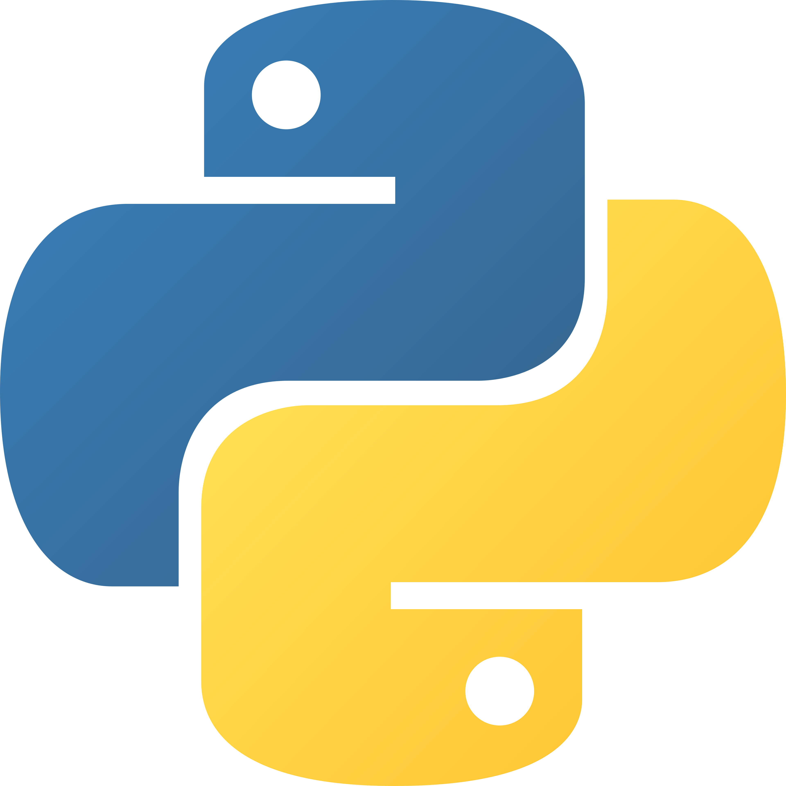
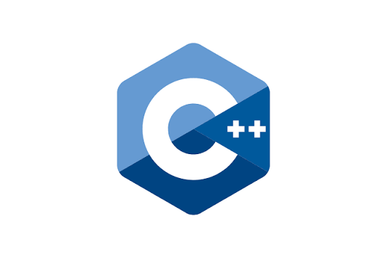

# Hola, soy Alejandro 👋

### Aprendiendo programación, un proyecto a la vez.

Python · C · C++

[Explora mis repositorios](https://github.com/alejondr3?tab=repositories)

---

## Sobre mí

Soy Alejandro Mendoza. En este perfil comparto ejercicios de programación, prácticas y proyectos universitarios: una forma de documentar lo que voy aprendiendo y seguir mejorando con cada reto.

## 🛠️ Lenguajes que uso

   &nbsp;&nbsp;
   &nbsp;&nbsp;
  

## 📂 Explora mi trabajo

| Repositorio | Qué encontrarás |
| --- | --- |
| [Ejercicios sobre vectores](https://github.com/alejondr3/100-ejercicios-practicos-sobre-vectores) | Práctica de programación con vectores. |
| [Fundamentos de programación](https://github.com/alejondr3/fundamentos-programacion-laboratorios) | Laboratorios para trabajar las bases de la programación. |
| [Práctico de C++](https://github.com/alejondr3/practico-segundo-parcial-cpp) | Ejercicios del segundo parcial. |
| [Proyecto de lengua de señas](https://github.com/alejondr3/lengua-de-se-as-proyecto-Universidad) | Proyecto universitario en versión beta, conservado como referencia. |

## 🌱 Aprender y compartir

Este perfil también es una bitácora de mi aprendizaje. Si revisas alguno de mis proyectos y tienes una sugerencia, será bienvenida.

---

  Gracias por pasar por aquí.

