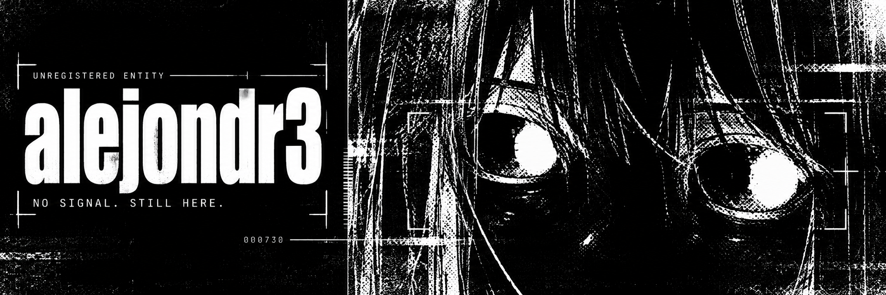
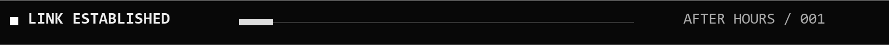
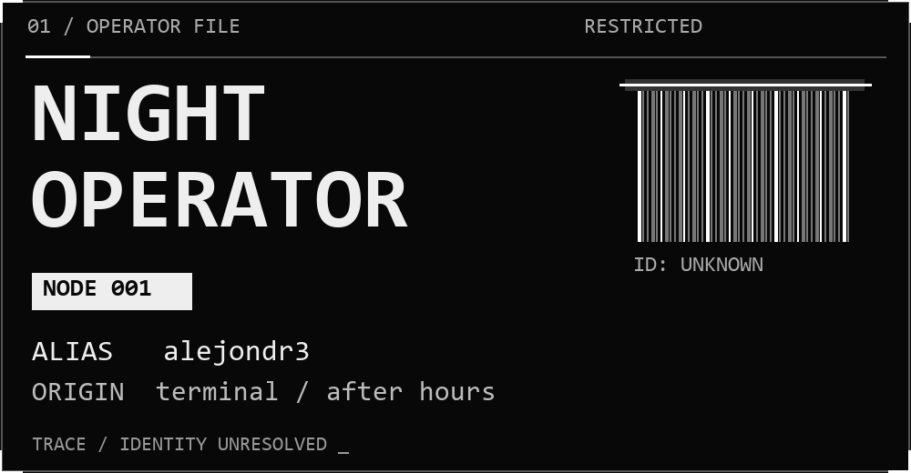
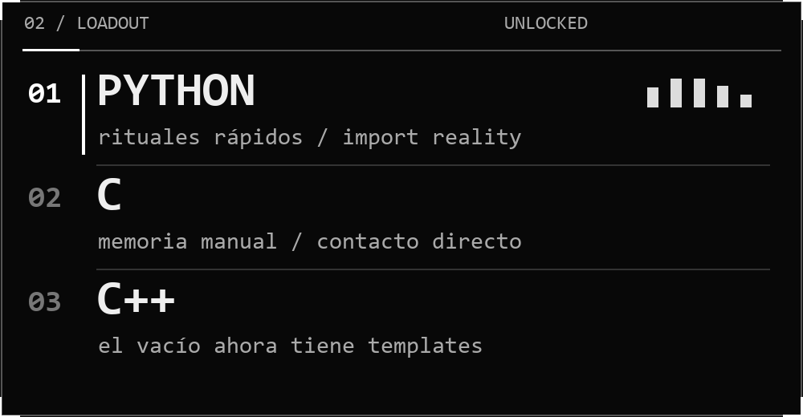
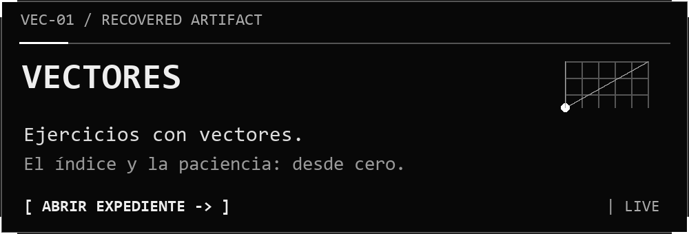
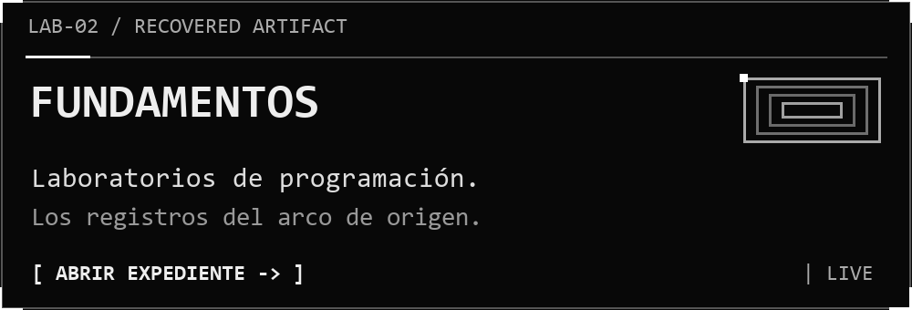
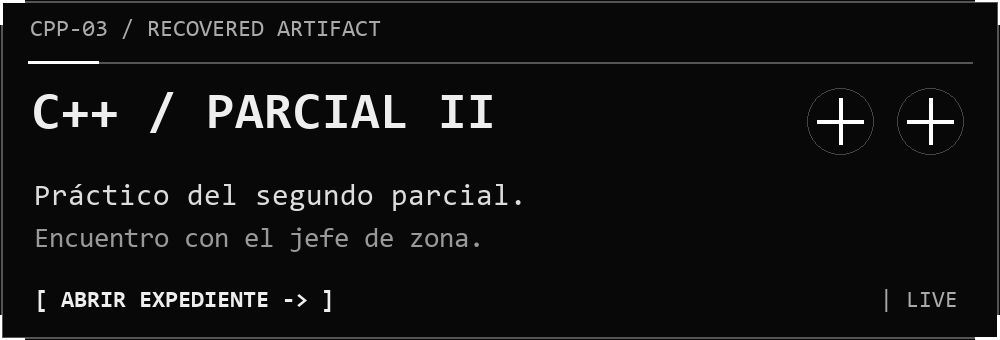
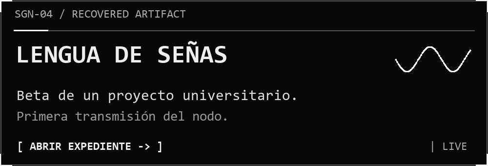
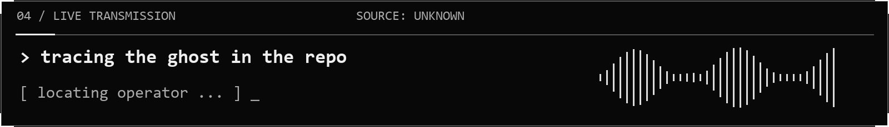
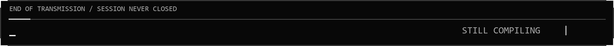

<p align="center">
  
  
</p>

<p align="center">
  <samp>「 la terminal sigue abierta. yo también. 」</samp>
</p>

<p align="center">
  <a href="#expediente">expediente</a>
  &nbsp; / &nbsp;
  <a href="#archivos-recuperados">archivos recuperados</a>
  &nbsp; / &nbsp;
  <a href="https://github.com/alejondr3?tab=repositories">todos los repositorios</a>
</p>

<br />

<a id="expediente"></a>

<p align="center">
  
  
</p>

<p align="center">
  De día, proyectos de la U. De noche, conversaciones con una terminal que responde en errores.<br />
  <b>No tengo un arco de entrenamiento. Tengo historial de commits.</b>
</p>

<br />

<a id="archivos-recuperados"></a>

### 03 / recovered artifacts

<p align="center">
  <a href="https://github.com/alejondr3/100-ejercicios-practicos-sobre-vectores"></a>
  <a href="https://github.com/alejondr3/fundamentos-programacion-laboratorios"></a>
</p>

<p align="center">
  <a href="https://github.com/alejondr3/practico-segundo-parcial-cpp"></a>
  <a href="https://github.com/alejondr3/lengua-de-se-as-proyecto-Universidad"></a>
</p>

<br />

<p align="center">
  
</p>

<br />

<details>
<summary><samp>[ RESTRICTED / acceder al expediente completo ]</samp></summary>

**Identidad civil:** Alejandro Mendoza.  
**Objetivo actual:** aprender programación, practicar y construir proyectos propios.  
**Debilidad conocida:** un último cambio antes de dormir.

Habito entre un `segmentation fault` y la idea de que esta vez sí va a funcionar.
Cada repositorio es un registro de expedición. Algunos contienen respuestas.
Otros explican por qué no se debe tocar ese puntero.

Si encontraste un bug, dejaste de ser visitante. Ahora eres parte del lore.
Se aceptan sugerencias, teorías y explicaciones de por qué ayer sí compilaba.

```text
03:07  iniciando "un cambio pequeño"
03:19  el cambio pequeño tiene dependencias
03:46  he adquirido conocimiento prohibido sobre punteros
04:12  funciona
04:13  no sé por qué
04:14  git commit
--:--  la sesión nunca se cerró
```

</details>

<br />

<p align="center">
  
</p>
