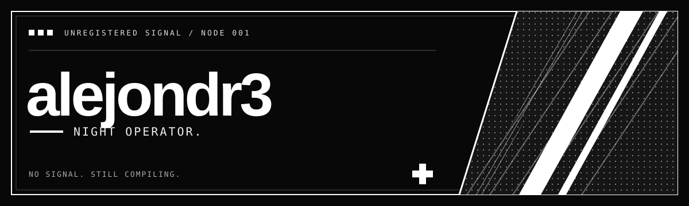

<p align="center">
  
</p>

<p align="center">
  <samp>「 la terminal sigue abierta. yo también. 」</samp>
</p>

<p align="center">
  <a href="#01--operator-file">expediente</a>
  &nbsp; / &nbsp;
  <a href="#02--loadout">arsenal</a>
  &nbsp; / &nbsp;
  <a href="#03--recovered-artifacts">archivos recuperados</a>
</p>

<br />

```text
[ CONNECTION ESTABLISHED ]

alias ............. alejondr3
civilian identity . Alejandro Mendoza
class ............. nocturnal compiler
alignment ......... chaotic curious
current objective . convertir cafeína en instrucciones
known weakness .... un último cambio antes de dormir

> el compilador conoce mi nombre real.
```

### 01 / operator file

De día, proyectos de la U.  
De noche, conversaciones con una terminal que responde en errores.

Habito entre un `segmentation fault` y la idea de que esta vez sí va a funcionar.
Cada repositorio es un registro de expedición. Algunos contienen respuestas.
Otros explican por qué no se debe tocar ese puntero.

> No tengo un arco de entrenamiento. Tengo historial de commits.

<br />

### 02 / loadout

<p>
  
  
  
</p>

```text
PYTHON  / invocaciones rápidas. el ritual empieza con import.
C       / contacto directo con el vacío. trae tu propia memoria.
C++     / el vacío ahora tiene templates.
```

<br />

### 03 / recovered artifacts

| ID | Archivo | Informe de campo |
| :--- | :--- | :--- |
| `VEC-01` | **[Vectores](https://github.com/alejondr3/100-ejercicios-practicos-sobre-vectores)** | Ejercicios con vectores. El índice empieza en cero; la paciencia también. |
| `LAB-02` | **[Fundamentos](https://github.com/alejondr3/fundamentos-programacion-laboratorios)** | Laboratorios de programación. Los registros del arco de origen. |
| `CPP-03` | **[Práctico C++](https://github.com/alejondr3/practico-segundo-parcial-cpp)** | Segundo parcial. Encuentro con el jefe de zona. |
| `SGN-04` | **[Lengua de señas](https://github.com/alejondr3/lengua-de-se-as-proyecto-Universidad)** | Beta universitaria preservada. Primera señal enviada desde este nodo. |

<p align="right">
  <a href="https://github.com/alejondr3?tab=repositories"><samp>abrir el archivo completo →</samp></a>
</p>

<br />

### 04 / incoming transmission

Si encontraste un bug, dejaste de ser visitante. Ahora eres parte del lore.  
Se aceptan sugerencias, teorías y explicaciones de por qué ayer sí compilaba.

<details>
<summary><samp>[ acceder al registro de la última sesión ]</samp></summary>

```text
03:07  iniciando "un cambio pequeño"
03:19  el cambio pequeño tiene dependencias
03:46  he adquirido conocimiento prohibido sobre punteros
04:12  funciona
04:13  no sé por qué
04:14  git commit
--:--  la sesión nunca se cerró
```

</details>

---

<p align="center">
  <samp>NO SIGNAL. STILL COMPILING.</samp><br />
  <sub>fin de la transmisión / inicio del siguiente intento</sub>
</p>
